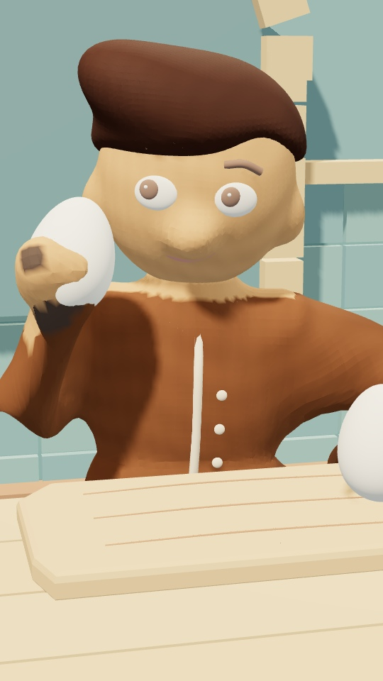
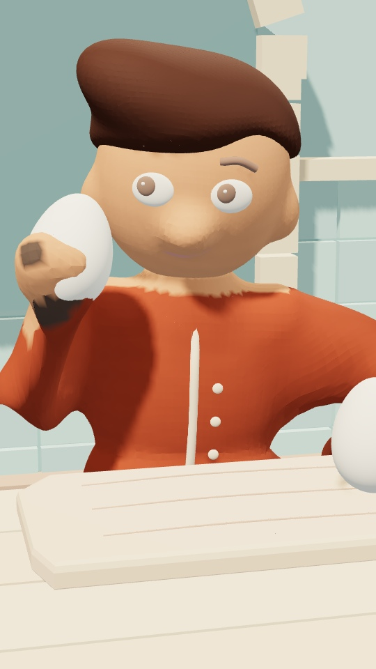

# New Animation Suggestion

Two matched 15-second Three.js character tests for The Prompt Warrior's *Two Eggs and the Angry King*. Smooth Wood and Soft Clay share Percy's geometry, joint weights, blocking, facial cues, dialogue edit, and Dollhouse kitchen staging.

| Smooth Wood | Soft Clay |
| --- | --- |
|  |  |
| Matte beige beech, warm chestnut fabric, quiet directional grain. | Matte burnt terracotta, peach skin, subtle variation, cool turquoise fill. |

Open `index.html` in Chrome to see the live 3D scene. Pick a look, then use Play or scrub. The renderer uses Chrome/Chromium, Node.js 22+, and FFmpeg. Run `node render.mjs` to render both, `node render.mjs wood` or `node render.mjs clay` to render one, and `node render.mjs --poster` for JPEG review frames. The original voice edit is supplied with the local screening package at `assets/percy-dialogue.m4a`. The public source can be auditioned silently and renders silent previews if that audio file is absent.

- `percy-rig.js` builds the continuous weighted body, sculpted head and hair, and facial controls.
- `performance.js` holds foot plants, arm targets, camera marks, reactions, and word-level mouth cues.
- `dollhouse-kitchen.js` reuses the worktable, oval-edged egg board, ceramic bowl, turquoise tile, arch, and copper pieces from the previous Dollhouse trial. The egg board sits near Percy's side of the table.
- [Generation protocol](AGENTS.md) applies to new generations in this folder.
- [Style descriptions and reusable prompts](STYLE-PROMPTS.md) describe the two approved directions and their performance.

Approved look references [Smooth Wood](https://chatgpt.com/library?file_id=libfile_05f16f45e5908191ab6082c83eee6b3e&account_id=personal) and [Soft Clay](https://chatgpt.com/library?file_id=libfile_0b0980911a088191a16623102f192905&account_id=personal). The JPEGs shown above are frames rendered from this 3D implementation.
